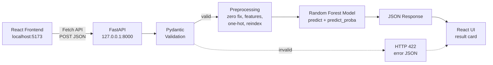
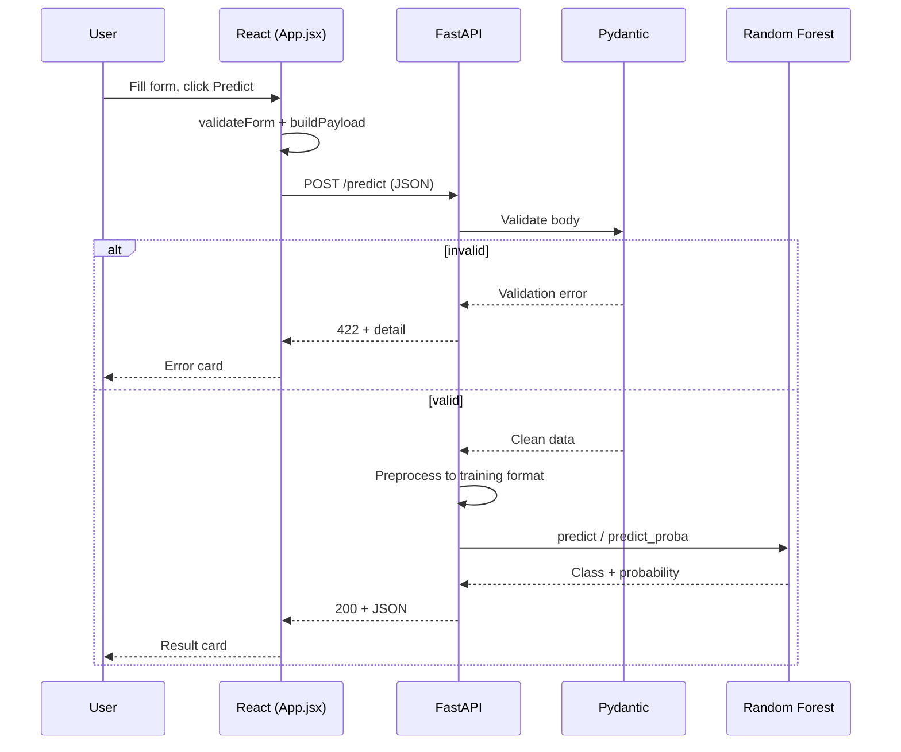
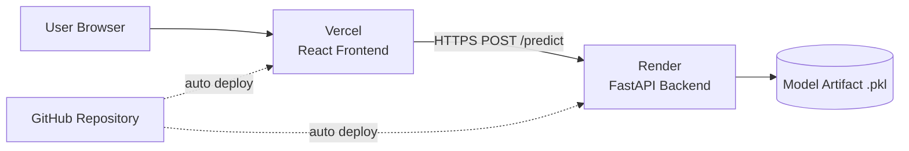

# Heart Disease Prediction System: Technical Documentation

**Project type:** End-to-end machine learning web application
**Stack:** Python · Scikit-learn · FastAPI · React (Vite)
**Status:** Local development complete · Deployment planned

> ⚠️ **Medical disclaimer.** This is an **educational machine learning project**. It is **not** a medically validated diagnostic tool. The prediction and probability must **not** be treated as a clinical diagnosis. Always consult a qualified healthcare professional.

---

## Documentation Conventions

This document separates what is finished from what is planned or unconfirmed.

| Marker | Meaning |
|---|---|
| ✅ **Completed** | Implemented and working in local development |
| 🧪 **Observed** | A test result that was actually observed |
| 🔍 **To be verified** | Detail not confirmed from the source files. Check it against the repository before publishing |
| 🗓️ **Planned** | Future work that has **not** been done yet |

> **Source-of-truth note.** The frontend sections (7 and 8) describe the actual `App.jsx` and `App.css` delivered for this project. The backend, notebook and `requirements.txt` details come from the project owner's description. Anything not confirmed from the files themselves is marked 🔍. A checklist of items to verify is in [Appendix A](#appendix-a-verification-checklist).

---

## Table of Contents

1. [Project Overview](#1-project-overview)
2. [Complete Technology Stack](#2-complete-technology-stack)
3. [Project Development Journey](#3-project-development-journey)
   - [Phase 1: Dataset and Machine Learning](#phase-1-dataset-and-machine-learning)
   - [Phase 2: Model Artifact Creation](#phase-2-model-artifact-creation)
   - [Phase 3: Backend Development with FastAPI](#phase-3-backend-development-with-fastapi)
   - [Phase 4: Frontend Development with React](#phase-4-frontend-development-with-react)
4. [API Input Parameters](#4-api-input-parameters)
5. [API Endpoints](#5-api-endpoints)
6. [Understanding HTTP Status Codes](#6-understanding-http-status-codes)
7. [Frontend Development with React](#7-frontend-development-with-react)
8. [How the Frontend Connects to the Backend](#8-how-the-frontend-connects-to-the-backend)
9. [CORS Configuration](#9-cors-configuration)
10. [Complete Project Folder Structure](#10-complete-project-folder-structure)
11. [Windows Setup and Terminal Commands](#11-windows-setup-and-terminal-commands)
12. [Library Versions](#12-library-versions)
13. [Testing and Validation](#13-testing-and-validation)
14. [Deployment Preparation (Planned)](#14-deployment-preparation-planned)
15. [Security, Limitations and Future Improvements](#15-security-limitations-and-future-improvements)
16. [Glossary](#16-glossary)
- [Appendix A: Verification Checklist](#appendix-a-verification-checklist)

---

## 1. Project Overview

**Project name:** Heart Disease Prediction System

**Objective.** Build a machine learning application that:

1. Accepts 11 patient health parameters through a web form.
2. Sends them to a backend API.
3. Preprocesses them in exactly the same way as the training data.
4. Uses a trained **Random Forest classifier** to predict heart disease.
5. Displays the prediction and the estimated probability in a React interface.

### Architecture at a glance

| Layer | Technology | Responsibility |
|---|---|---|
| Machine learning | Python, Pandas, NumPy, Scikit-learn | Data analysis, feature engineering, model training |
| Model storage | Joblib (`.pkl` artifact) | Saves the model plus preprocessing information |
| Backend | FastAPI, Pydantic, Uvicorn | Validates input, preprocesses, predicts, returns JSON |
| Frontend | React + Vite | Collects input, calls the API, shows results |
| Communication | HTTP POST with Fetch API (JSON) | Moves data between frontend and backend |

### Project status

| Area                                          | Status      |
| --------------------------------------------- | ----------- |
| Data analysis and model training              | ✅ Completed |
| Model artifact (`heart_disease_artifact.pkl`) | ✅ Completed |
| FastAPI backend (`GET /`, `POST /predict`)    | ✅ Completed |
| React + Vite frontend                         | ✅ Completed |
| Local end-to-end testing                      | ✅ Completed |
| Git / GitHub repository                       | 🗓️ Planned |
| Backend deployment on Render                  | 🗓️ Planned |
| Frontend deployment on Vercel                 | 🗓️ Planned |

---

## 2. Complete Technology Stack

> **Honesty note.** Libraries and tools below are described as "used" only where the project's purpose clearly requires them or the source confirms them. Items whose use is only part of the development environment are labelled **Environment**. Items needing confirmation from the notebook or `requirements.txt` are marked 🔍.

### 2.1 Programming languages

| Technology | What it is | Why it was used | Where it is used | Role in the application |
|---|---|---|---|---|
| **Python** | General-purpose language, standard for data science | Rich ML ecosystem and FastAPI support | Notebook, `backend/app/main.py` | Trains the model and serves predictions |
| **JavaScript** | The language of web browsers | Required for interactive web UIs | `frontend/src/App.jsx` | Form logic, API calls, result rendering |
| **HTML** | Markup language for page structure | Foundation of every web page | Rendered through React JSX and Vite's `index.html` | Page structure |
| **CSS** | Styling language for web pages | Layout, colours, animation, responsiveness | `frontend/src/App.css` | Visual design of the dashboard |

### 2.2 Machine learning and data processing

| Technology | What it is | Why it was used | Where it is used | Role |
|---|---|---|---|---|
| **Pandas** | Tabular data library (DataFrames) | Load, inspect, clean and transform the dataset | Notebook, and the backend (building a one-row DataFrame) | Data handling in training and inference |
| **NumPy** | Numerical computing library | Fast array maths | Notebook (numeric operations) 🔍 | Numeric support for Pandas and Scikit-learn |
| **Scikit-learn** | Classic ML library | Provides `RandomForestClassifier`, evaluation tools | Notebook (training, evaluation) | Builds the prediction model |
| **Joblib** | Python object serialization tool | Efficiently saves and loads trained models | Notebook (save), backend (load) | Moves the trained model from notebook to API |
| **Matplotlib** | Plotting library | Visualise distributions and results | Notebook, EDA 🔍 | Exploratory visualisation |
| **Seaborn** | Statistical plotting library built on Matplotlib | Cleaner statistical charts | Notebook, EDA 🔍 | Exploratory visualisation |

### 2.3 Backend

| Technology | What it is | Why it was used | Where it is used | Role |
|---|---|---|---|---|
| **FastAPI** | Modern Python web framework | Fast, automatic validation and automatic API docs | `backend/app/main.py` | Defines the endpoints |
| **Uvicorn** | ASGI web server | FastAPI needs an ASGI server to run | Terminal: `python -m uvicorn app.main:app --reload` | Hosts the API locally |
| **Pydantic** | Data validation library using Python type hints | Rejects invalid input before prediction runs | Input schema in `main.py` | Enforces types and ranges (e.g. Age ≤ 100) |
| **Python virtual environment** | Isolated Python environment | Keeps project packages separate from other projects | `backend/venv/` | Reproducible dependencies |
| **CORS Middleware** | FastAPI/Starlette middleware | Lets the browser frontend call the API from another origin | `main.py` | Allows React (port 5173) to call FastAPI (port 8000) |

### 2.4 Frontend

| Technology | What it is | Why it was used | Where it is used | Role |
|---|---|---|---|---|
| **React** | JavaScript UI library | Component-based UI with managed state | `src/App.jsx` | Entire interface |
| **Vite** | Frontend build tool and dev server | Very fast start and hot reload | Project scaffold, `npm run dev` | Serves the app locally |
| **JavaScript (ES6+)** | Modern JS syntax | `async/await`, destructuring, arrow functions | `App.jsx` | Application logic |
| **CSS** | Styling | Responsive, premium healthcare look | `src/App.css` | Styling and animation |
| **Fetch API** | Browser built-in HTTP client | No extra dependency needed | `handleSubmit` in `App.jsx` | Sends the POST request |
| **React Hooks** | `useState`, `useEffect`, `useRef` | State, side effects and DOM references | `App.jsx` | Form state, loading state, scroll tracking |

### 2.5 Development tools

| Technology | What it is | Role in this project |
|---|---|---|
| **Visual Studio Code** | Code editor | Main editor for backend and frontend (Environment) |
| **Jupyter Notebook** | Interactive notebook environment | Data analysis and model training |
| **PowerShell** | Windows command-line shell | Running venv, pip, uvicorn, npm commands |
| **Anaconda / Python** | Python distribution and tooling | Python runtime (Environment; exact setup 🔍) |
| **Node.js** | JavaScript runtime outside the browser | Runs Vite and npm tooling |
| **npm** | Node package manager | Installs frontend packages, runs scripts |
| **Git** | Version control system | 🗓️ Planned |
| **GitHub** | Online hosting for Git repositories | 🗓️ Planned |
| **FastAPI Swagger UI** | Interactive API docs at `/docs` | Manual testing of GET and POST endpoints |

---

## 3. Project Development Journey

### Phase 1: Dataset and Machine Learning

> **Where the source of truth lives.** This phase was carried out in a Jupyter Notebook. The specific numbers (dataset size, metrics, chosen features) are **not** stated here because they have not been verified against the notebook. Fill them in from the notebook ([Appendix A](#appendix-a-verification-checklist)).

| Step | What happens | Why it matters |
|---|---|---|
| **1. Dataset loading** | The CSV dataset is loaded into a Pandas DataFrame | Everything starts from a DataFrame. Dataset file name: 🔍 |
| **2. Initial inspection** | Look at the first rows, shape, data types, summary statistics (`head()`, `info()`, `describe()`) | Reveals problems early |
| **3. Understanding columns** | Identify numeric columns (Age, RestingBP, Cholesterol, MaxHR, Oldpeak), binary (FastingBS), categorical (Sex, ChestPainType, RestingECG, ExerciseAngina, ST_Slope) and the target | Different types need different preprocessing |
| **4. Exploratory Data Analysis (EDA)** | Plot distributions and relationships (Matplotlib/Seaborn) | Builds intuition and spots anomalies |
| **5. Missing and invalid values** | Check for nulls and impossible values | Models learn badly from impossible data |
| **6. Zero-value handling** | `RestingBP` and `Cholesterol` contain zeros, which are not physiologically meaningful, so they are treated as invalid | Zeros would distort the learned patterns |
| **7. Replacement with training means** | Zeros are replaced with the **mean computed from the training data** | Using training-set statistics avoids data leakage. The same values are saved and reused in the API |
| **8. One-hot encoding** | Categorical text columns become 0/1 columns (e.g. `ChestPainType_ATA`) | Random Forests in Scikit-learn need numeric input |
| **9. Feature engineering** | Create new columns from existing ones (below) | Can expose patterns the raw columns hide |
| **10. Feature selection / importance** | Inspect which features matter most (`feature_importances_`) | Understand and prune the feature set |
| **11. Mutual Information** | Mutual information scoring of features | 🔍 Include **only if** present in the notebook |
| **12. Model training** | Fit a `RandomForestClassifier` on the training split | Produces the predictive model |
| **13. Evaluation** | Score the model on held-out test data | Estimates performance on unseen data. Metrics: 🔍 (not stated here) |
| **14. Saving** | Save the model and preprocessing info with Joblib | Lets the API reproduce the exact pipeline |

#### Engineered features

| Feature | Purpose | Exact formula |
|---|---|---|
| **AgeGroup** | Groups ages into bands using `age_group_bins` and `age_group_labels` | Bin edges and labels: 🔍 read from the saved artifact |
| **MaxHR_Percentage** | Expresses max heart rate relative to an age-related expectation | 🔍 Exact formula to be verified in the notebook |
| **Age_Oldpeak** | An interaction feature combining Age and Oldpeak | 🔍 Exact formula to be verified in the notebook |

> The backend must reproduce these formulas **exactly** as in the notebook. Any difference between training-time and prediction-time preprocessing is called *training-serving skew* and silently degrades predictions.

#### What is a Random Forest?

A Random Forest builds many decision trees on random subsets of data and features. For classification, each tree votes, and the majority wins. The share of trees voting for each class gives the **probability** shown in the UI (`predict_proba`). Hyperparameters used: 🔍.

---

### Phase 2: Model Artifact Creation

**Artifact file:** `heart_disease_artifact.pkl`

A single Python dictionary saved with Joblib that bundles the model **and** everything needed to preprocess new input:

| Key | Contents | Why it is stored |
|---|---|---|
| `model` | The trained `RandomForestClassifier` | Generates predictions |
| `feature_columns` | Ordered list of the columns the model was trained on | Guarantees the API builds input in the same layout |
| `cholesterol_mean` | Training mean for Cholesterol | Replaces zero values at prediction time |
| `resting_bp_mean` | Training mean for RestingBP | Replaces zero values at prediction time |
| `age_group_bins` | Bin edges for AgeGroup | Reproduces age grouping |
| `age_group_labels` | Labels for each age bin | Reproduces age grouping |

#### Why Joblib?

Joblib is designed for Python objects that contain large NumPy arrays, which Random Forests do. It serializes and loads them efficiently.

#### What is serialization?

Serialization turns an in-memory Python object into bytes that can be stored in a file (`.pkl`). *Deserialization* reverses it. Training happens once in the notebook. The API only loads the saved result and never retrains.

#### Why save preprocessing information with the model?

The model only understands data prepared exactly as it was during training. Saving the means, bins and column list alongside it keeps training and serving consistent. Hard-coding those numbers in the API would risk drift.

#### Why feature column order must be preserved

A Scikit-learn model sees a table of numbers, not names (depending on version). If columns arrive in a different order, values are interpreted as the wrong features. The API therefore calls `reindex(columns=feature_columns)`.

#### Saving and loading commands

Saving (notebook). Representative code, 🔍 confirm the variable names against your notebook:

```python
import joblib

artifact = {
    "model": model,
    "feature_columns": feature_columns,
    "cholesterol_mean": cholesterol_mean,
    "resting_bp_mean": resting_bp_mean,
    "age_group_bins": age_group_bins,
    "age_group_labels": age_group_labels,
}

joblib.dump(artifact, "heart_disease_artifact.pkl")
```

Loading (backend). Representative code, 🔍 confirm against `main.py`:

```python
import joblib

artifact = joblib.load(MODEL_PATH)
model = artifact["model"]
feature_columns = artifact["feature_columns"]
cholesterol_mean = artifact["cholesterol_mean"]
resting_bp_mean = artifact["resting_bp_mean"]
age_group_bins = artifact["age_group_bins"]
age_group_labels = artifact["age_group_labels"]
```

> ⚠️ **Security note.** Never load `.pkl` files from untrusted sources. Unpickling can execute arbitrary code.

---

### Phase 3: Backend Development with FastAPI

**Main file:** `backend/app/main.py`

> 🔍 The code blocks in this phase are **illustrative reference sketches** built from the described behaviour and the validation table in Section 4. Replace them with the exact code from your `main.py` before publishing.

#### The 20 operations of the backend

| # | Operation | Plain-language explanation |
|---|---|---|
| 1 | **Import libraries** | Bring in FastAPI, Pydantic, Pandas, NumPy, Joblib and CORS middleware |
| 2 | **Define base directory** | Compute the project path (usually from `__file__`) so the model is found regardless of where the server is launched |
| 3 | **Load the `.pkl` artifact** | `joblib.load(...)` runs once at startup, so every request reuses the loaded model |
| 4 | **Extract model and preprocessing info** | Pull `model`, `feature_columns`, means and age bins out of the dictionary |
| 5 | **Create the FastAPI app** | `app = FastAPI(...)`. This is the object Uvicorn serves |
| 6 | **Configure CORS** | Allow the React origin to call the API (Section 9) |
| 7 | **Create the Pydantic schema** | Declares the 11 fields, their types and limits |
| 8 | **GET `/` route** | Health check, returns a "running" message |
| 9 | **POST `/predict` route** | The main prediction endpoint |
| 10 | **Process incoming JSON** | FastAPI parses the body into the Pydantic object (`patient`) |
| 11 | **Replace zero values** | If RestingBP or Cholesterol is 0, substitute the stored training mean |
| 12 | **Calculate AgeGroup** | Bin the age with `age_group_bins` and `age_group_labels` |
| 13 | **Calculate engineered features** | Compute MaxHR_Percentage and Age_Oldpeak |
| 14 | **Create a Pandas DataFrame** | Wrap the single patient record into a one-row table |
| 15 | **One-hot encode** | `pd.get_dummies(...)` on the categorical columns |
| 16 | **Match training columns with `reindex`** | `reindex(columns=feature_columns, fill_value=0)` adds any missing dummy columns as 0 and fixes the order |
| 17 | **Generate the prediction** | `model.predict(...)` returns 0 or 1 |
| 18 | **Generate the probability** | `model.predict_proba(...)` returns class probabilities. The heart disease class probability is converted to a percentage |
| 19 | **Return JSON** | Dictionary with `prediction`, `result`, `heart_disease_probability` |
| 20 | **Handle exceptions** | Re-raise `HTTPException`, and convert unexpected errors into a clean HTTP 500 |

#### Reference sketch: schema, app and CORS

```python
from fastapi import FastAPI, HTTPException
from fastapi.middleware.cors import CORSMiddleware
from pydantic import BaseModel, Field

app = FastAPI()

app.add_middleware(
    CORSMiddleware,
    allow_origins=["http://localhost:5173"],
    allow_credentials=True,
    allow_methods=["*"],
    allow_headers=["*"],
)

class PatientData(BaseModel):
    Age: int = Field(..., ge=1, le=100)
    Sex: str
    ChestPainType: str
    RestingBP: float = Field(..., ge=0, le=300)
    Cholesterol: float = Field(..., ge=0, le=700)
    FastingBS: int = Field(..., ge=0, le=1)
    RestingECG: str
    MaxHR: int = Field(..., ge=1, le=250)
    ExerciseAngina: str
    Oldpeak: float
    ST_Slope: str
```

> 🔍 The exact way `Sex`, `ChestPainType`, etc. are restricted (`Literal`, regex pattern, or unrestricted `str`) must be confirmed from `main.py`.

#### Reference sketch: the two routes

```python
@app.get("/")
def home():
    return {"message": "Heart Disease Prediction API is running!"}

@app.post("/predict")
def predict(patient: PatientData):
    try:
        # 1. Replace zero values using training means
        # 2. Compute AgeGroup using age_group_bins / age_group_labels
        # 3. Compute MaxHR_Percentage and Age_Oldpeak
        # 4. Build a one-row DataFrame and one-hot encode it
        # 5. input_df = input_df.reindex(columns=feature_columns, fill_value=0)
        # 6. prediction = model.predict(input_df)[0]
        # 7. probability = model.predict_proba(input_df)[0][1] * 100
        return {
            "prediction": int(prediction),
            "result": "...",  # 🔍 exact text for both classes
            "heart_disease_probability": round(float(probability), 2),
        }
    except HTTPException:
        raise
    except Exception as e:
        raise HTTPException(status_code=500, detail=str(e))
```

> 🔍 Replace the comments with your real implementation. Rounding to two decimals is consistent with the observed value `39.56`, but confirm it in `main.py`.

#### Why the model is loaded once

Loading a model on every request would be slow. Loading at startup means each request only runs the lightweight preprocessing and prediction steps.

---

### Phase 4: Frontend Development with React

The frontend was built after the backend was verified through Swagger UI. It was then redesigned into a premium healthcare dashboard without changing the backend or its API contract. Full details are in [Section 7](#7-frontend-development-with-react) and [Section 8](#8-how-the-frontend-connects-to-the-backend).

Two refinements were applied after testing:

| Refinement | Reason |
|---|---|
| `toPercent()` simplified to treat the backend value as already being a percentage (0–100) | The backend returns percentages (e.g. `39.56`). The earlier version guessed 0–1 versus 0–100, so a value such as `0.5` (meaning 0.5%) could have displayed as `50%` |
| Age maximum in the frontend changed from `120` to `100` | Matches the backend Pydantic limit, so invalid ages are caught in the form with a friendly message |

---

## 4. API Input Parameters

All 11 fields are required. Field names are case-sensitive and must match exactly.

| Parameter | Expected type | Validation / expected values |
|---|---|---|
| `Age` | Integer | 1–100 |
| `Sex` | String | `M` / `F` |
| `ChestPainType` | String | `ATA` / `NAP` / `TA` / `ASY` |
| `RestingBP` | Float | 0–300 |
| `Cholesterol` | Float | 0–700 |
| `FastingBS` | Integer | `0` or `1` |
| `RestingECG` | String | `Normal` / `ST` / `LVH` |
| `MaxHR` | Integer | 1–250 |
| `ExerciseAngina` | String | `Y` / `N` |
| `Oldpeak` | Float | Numeric |
| `ST_Slope` | String | `Up` / `Flat` / `Down` |

### What each parameter represents

*These are descriptions of dataset attributes only. They make no diagnostic claims.*

| Parameter | Meaning |
|---|---|
| **Age** | Patient age in years |
| **Sex** | Biological sex: M (male) or F (female) |
| **ChestPainType** | Category of chest pain: **TA** typical angina, **ATA** atypical angina, **NAP** non-anginal pain, **ASY** asymptomatic |
| **RestingBP** | Resting blood pressure, in mm Hg |
| **Cholesterol** | Serum cholesterol, in mg/dl |
| **FastingBS** | Fasting blood sugar indicator: `1` if above 120 mg/dl, otherwise `0` |
| **RestingECG** | Resting electrocardiogram result: **Normal**, **ST** (ST-T wave abnormality), **LVH** (left ventricular hypertrophy) |
| **MaxHR** | Maximum heart rate achieved, in beats per minute |
| **ExerciseAngina** | Whether exercise induced angina: Y (yes) or N (no) |
| **Oldpeak** | ST depression induced by exercise relative to rest (a decimal value) |
| **ST_Slope** | Slope of the peak-exercise ST segment: **Up**, **Flat**, **Down** |

### Pydantic validation code

> 🔍 The block below is reconstructed from the validation table above. **Replace it with the actual schema from `backend/app/main.py`.**

```python
class PatientData(BaseModel):
    Age: int = Field(..., ge=1, le=100)
    Sex: str
    ChestPainType: str
    RestingBP: float = Field(..., ge=0, le=300)
    Cholesterol: float = Field(..., ge=0, le=700)
    FastingBS: int = Field(..., ge=0, le=1)
    RestingECG: str
    MaxHR: int = Field(..., ge=1, le=250)
    ExerciseAngina: str
    Oldpeak: float
    ST_Slope: str
```

### Frontend versus backend validation ranges

The frontend validates before sending. Its limits are intentionally friendly, and in two cases stricter than the backend:

| Field | Backend limit | Frontend limit (`NUMBER_RULES`) |
|---|---|---|
| Age | 1–100 | 1–100 (whole number) |
| RestingBP | 0–300 | 0–300 (whole number) |
| Cholesterol | 0–700 | 0–700 (whole number) |
| MaxHR | 1–250 | **30–250** (whole number) |
| Oldpeak | Any number | **−5 to 10** (decimal) |

> The frontend `MaxHR` minimum (30) and `Oldpeak` range (−5 to 10) are **UI sanity limits chosen in the frontend**, not backend rules. They are stricter than the API, which would accept `MaxHR` from 1. Adjust them in `NUMBER_RULES` if you want exact parity.

---

## 5. API Endpoints

### `GET /`

**Purpose:** Check whether the API is running.

**Response (200):**

```json
{
  "message": "Heart Disease Prediction API is running!"
}
```

### `POST /predict`

**Purpose:** Receive patient information and return a prediction.

| Property | Value |
|---|---|
| HTTP method | `POST` |
| Local URL | `http://127.0.0.1:8000/predict` |
| Request content type | `application/json` |
| Swagger UI | `http://127.0.0.1:8000/docs` |

**Processing:** Pydantic validation, zero replacement, feature engineering, one-hot encoding, `reindex`, `predict`, `predict_proba`, JSON response.

#### Example request

```json
{
  "Age": 54,
  "Sex": "M",
  "ChestPainType": "ASY",
  "RestingBP": 140,
  "Cholesterol": 239,
  "FastingBS": 0,
  "RestingECG": "Normal",
  "MaxHR": 160,
  "ExerciseAngina": "N",
  "Oldpeak": 1.2,
  "ST_Slope": "Flat"
}
```

*This is the same sample the frontend's "Fill sample values" button fills in. The 39.56 response below was observed with the project's tested inputs. The exact inputs used in that test: 🔍.*

#### Example response

```json
{
  "prediction": 0,
  "result": "No heart disease detected",
  "heart_disease_probability": 39.56
}
```

> **Important.** This is an example of a **previously observed response**, not a guaranteed result for all inputs. The text for a positive prediction (`prediction: 1`): 🔍.

#### Response fields

| Field | Type | Meaning |
|---|---|---|
| `prediction` | Integer | `0` = no heart disease predicted, `1` = heart disease predicted |
| `result` | String | Human-readable version of the prediction |
| `heart_disease_probability` | Number | Model-estimated probability of heart disease, **as a percentage (0–100)** |

---

## 6. Understanding HTTP Status Codes

| Code | Name | Meaning in this project |
|---|---|---|
| **200** | OK | Request was valid and a prediction was returned |
| **400** | Bad Request | The request was malformed or logically invalid. Raised manually in code if needed |
| **422** | Unprocessable Content | The JSON was well-formed but failed Pydantic validation (wrong type or out of range). FastAPI returns this automatically |
| **500** | Internal Server Error | Something unexpected failed on the server (for example a preprocessing error) |

### Actual validation test

We deliberately sent an invalid age:

```json
{ "Age": 150, "...": "other valid fields" }
```

The backend returned **HTTP 422**:

```json
{
  "detail": [
    {
      "type": "less_than_equal",
      "loc": ["body", "Age"],
      "msg": "Input should be less than or equal to 100",
      "input": 150,
      "ctx": { "le": 100 }
    }
  ]
}
```

### Why it was rejected

| Part | Meaning |
|---|---|
| `type: "less_than_equal"` | The rule that failed is a "less than or equal" constraint (`le=100`) |
| `loc: ["body", "Age"]` | The problem is in the request **body**, field **Age** |
| `msg` | Human-readable explanation |
| `input: 150` | The value that was received |
| `ctx: {"le": 100}` | The limit that was exceeded |

### How Pydantic validates before prediction

1. FastAPI receives the request and reads the JSON body.
2. FastAPI passes the body to the Pydantic model declared in the function signature.
3. Pydantic checks types and constraints.
4. **If validation fails**, FastAPI immediately answers with 422. **The `predict` function body never runs.**
5. If validation passes, the function runs with clean, typed data.

This protects the model from nonsense input and gives clients precise error messages.

---

## 7. Frontend Development with React

> This section describes the actual `src/App.jsx` and `src/App.css` delivered for the project.

### Why React and Vite?

| Choice | Reason |
|---|---|
| **React** | Component-based UI. State changes (typing, loading, results) update the screen automatically |
| **Vite** | Near-instant dev server start, hot reload, simple configuration |

### How the frontend project was created

```powershell
npm create vite@latest frontend -- --template react
```

### Files

| File | Purpose |
|---|---|
| `src/App.jsx` | The entire application: constants, helpers, components, state, API call |
| `src/App.css` | All styling: design tokens, layout, animations, responsive rules |

No extra npm dependencies were added. Icons are inline SVG and fonts load from Google Fonts with system fallbacks.

### Structure of `App.jsx`

**Configuration and helpers**

| Name | Purpose |
|---|---|
| `API_URL` | `"http://127.0.0.1:8000/predict"` |
| `INITIAL_FORM` | Empty values for all 11 fields |
| `SAMPLE_INPUT` | Optional test values for the "Fill sample values" button (input only, never a fake result) |
| `NUMBER_RULES` | Min, max, step and integer rule for the five numeric fields |
| `CHEST_PAIN_OPTIONS`, `RESTING_ECG_OPTIONS`, `ST_SLOPE_OPTIONS` | Dropdown options |
| `validateForm(form)` | Returns an object of error messages |
| `buildPayload(form)` | Builds the JSON body with the correct types |
| `toPercent(value)` | Clamps the backend value to 0–100 |
| `extractErrorMessage(response)` | Turns an error response (including FastAPI 422) into readable text |

**Components**

| Component | Purpose |
|---|---|
| `Icon` | Inline SVG icon helper |
| `Field`, `NumberField`, `SelectField`, `SegmentedField` | Reusable input components |
| `FormSection` | Groups related fields with a title and icon |
| `Navbar` | Logo and Dashboard / Prediction / About links, with a mobile menu |
| `HeartVisual`, `Hero`, `FeatureStrip` | Landing section with an animated heart and an "AI Powered" indicator |
| `ResultPanel` | Shows empty, loading, error and result states |
| `App` | Main component: state, handlers, layout |

### How the 11 inputs are represented

| Field | Input type in the UI |
|---|---|
| Age, RestingBP, Cholesterol, MaxHR, Oldpeak | Number inputs with unit labels |
| Sex, FastingBS, ExerciseAngina | Segmented toggle buttons |
| ChestPainType, RestingECG, ST_Slope | Dropdown selects |

The form is grouped into three sections: **Patient profile**, **Vitals & blood work**, **Cardiac tests & symptoms**.

### State management (React Hooks)

| State | Hook | Purpose |
|---|---|---|
| `form` | `useState` | Current value of every field |
| `errors` | `useState` | Per-field validation messages |
| `loading` | `useState` | Whether a request is in progress |
| `result` | `useState` | The API response |
| `apiError` | `useState` | Error text for the error card |
| `activeSection` | `useState` | Which nav link is highlighted |
| `resultRef` | `useRef` | Scrolls to the result card on small screens |
| Scroll observer | `useEffect` | Highlights the current nav section using `IntersectionObserver` |

### Input validation

`validateForm` runs on submit:

- Numeric fields must be present, numeric, in range, and whole numbers where required.
- Dropdown and toggle fields must have a selection.
- If any error exists, the request is **not sent**. The page scrolls to the first error and each field shows a message (for example "Enter a value between 1 and 100.").

### Predict button, loading and errors

| Behaviour | Implementation |
|---|---|
| Predict button | Submits the form and calls `handleSubmit` |
| Loading state | `loading` is set to `true`. The button shows a spinner and "Analysing…" and is disabled. The result column shows a pulsing heart and skeleton placeholders |
| Network failure | A `TypeError` from `fetch` shows "Unable to reach the prediction server…" |
| Server error (e.g. 422) | `extractErrorMessage` reads `detail` and shows readable text in a red error card |

### Result display and probability formatting

- `prediction === 1` shows the red "Elevated risk detected" state. Otherwise the green "Low risk indicated" state.
- The card shows `result.result` as the title.
- The probability is passed through `toPercent`, then displayed with `toFixed(1)`: **39.56 → 39.6%**.
- It is drawn as a circular gauge and a progress bar.

```jsx
// Backend already returns the probability as a percentage (0-100).
function toPercent(value) {
  const num = Number(value);
  if (Number.isNaN(num)) return 0;
  return Math.min(100, Math.max(0, num));
}
```

### Responsive design

`App.css` contains media queries at **1023px** and **767px**:

| Screen | Behaviour |
|---|---|
| Desktop (≥1024px) | Two-column layout: form on the left, sticky result card on the right |
| Tablet (≤1023px) | Single column |
| Mobile (≤767px) | Hamburger menu, stacked form fields, full-width buttons |

The CSS also respects `prefers-reduced-motion`.

---

## 8. How the Frontend Connects to the Backend

### Step-by-step flow

| # | Step | Where it happens |
|---|---|---|
| 1 | User enters patient details | React form |
| 2 | React stores values in form state | `useState` → `form` |
| 3 | User clicks **Predict Heart Disease** | `handleSubmit` triggered |
| 4 | React validates input | `validateForm(form)` |
| 5 | React creates the JSON payload | `buildPayload(form)` |
| 6 | React sends an HTTP POST using Fetch | `fetch(API_URL, {...})` |
| 7 | FastAPI receives the request | `POST /predict` |
| 8 | Pydantic validates the data | Input schema |
| 9 | FastAPI preprocesses | Zero replacement, features, one-hot, `reindex` |
| 10 | Random Forest generates prediction and probability | `predict`, `predict_proba` |
| 11 | FastAPI returns JSON | `prediction`, `result`, `heart_disease_probability` |
| 12 | React receives the response | `await response.json()` |
| 13 | React updates state | `setResult(data)` |
| 14 | UI displays prediction and probability | `ResultPanel` |

### Architecture diagram



### Sequence diagram



### The actual Fetch implementation

From `handleSubmit` in `App.jsx`:

```jsx
try {
  const response = await fetch(API_URL, {
    method: "POST",
    headers: { "Content-Type": "application/json" },
    body: JSON.stringify(buildPayload(form)),
  });

  if (!response.ok) {
    throw new Error(await extractErrorMessage(response));
  }

  const data = await response.json();
  setResult(data);
} catch (err) {
  if (err instanceof TypeError) {
    setApiError(
      "Unable to reach the prediction server at http://127.0.0.1:8000. Please make sure the backend is running."
    );
  } else {
    setApiError(err.message || "Something went wrong while contacting the server.");
  }
} finally {
  setLoading(false);
}
```

### The payload builder

```jsx
function buildPayload(form) {
  return {
    Age: Number(form.Age),
    Sex: form.Sex,
    ChestPainType: form.ChestPainType,
    RestingBP: Number(form.RestingBP),
    Cholesterol: Number(form.Cholesterol),
    FastingBS: Number(form.FastingBS),
    RestingECG: form.RestingECG,
    MaxHR: Number(form.MaxHR),
    ExerciseAngina: form.ExerciseAngina,
    Oldpeak: Number(form.Oldpeak),
    ST_Slope: form.ST_Slope,
  };
}
```

Form inputs hold text, so numeric fields are converted with `Number(...)`. FastAPI/Pydantic expects numbers, not strings.

### What each concept means

| Term | Meaning |
|---|---|
| `fetch()` | Browser function that makes an HTTP request and returns a Promise |
| `method: "POST"` | Sends data in the request body to create or process something |
| `headers` | Extra information about the request |
| `Content-Type: application/json` | Tells the server the body is JSON |
| `JSON.stringify()` | Converts a JavaScript object into a JSON string |
| `response.ok` | `true` when the status is 200–299. `false` for 4xx/5xx, which this app treats as errors |
| `response.json()` | Reads the response body and parses it into a JavaScript object (asynchronous) |
| `async/await` | Lets asynchronous code read like normal sequential code |
| **CORS** | Browser security rule controlling cross-origin requests (Section 9) |
| **API endpoint** | A specific URL a service exposes, here `/predict` |

---

## 9. CORS Configuration

### What is CORS?

**Cross-Origin Resource Sharing** is a browser security mechanism. An *origin* is the combination of **protocol + host + port**. By default, a web page may only make requests to its **own** origin unless the other server explicitly allows it.

### Why it was required

| Service | Origin |
|---|---|
| React (Vite dev server) | `http://localhost:5173` |
| FastAPI (Uvicorn) | `http://127.0.0.1:8000` |

They differ in host and port, so the browser treats them as **different origins**. Without permission from the backend, the browser blocks the frontend from reading the API response.

### The configuration

```python
app.add_middleware(
    CORSMiddleware,
    allow_origins=["http://localhost:5173"],
    allow_credentials=True,      # 🔍 confirm against main.py
    allow_methods=["*"],         # 🔍 confirm against main.py
    allow_headers=["*"],         # 🔍 confirm against main.py
)
```

Only the `allow_origins=["http://localhost:5173"]` value is confirmed. The other arguments are typical values to verify.

### What happens if CORS is wrong?

- The browser console shows an error such as *"blocked by CORS policy: No 'Access-Control-Allow-Origin' header"*.
- The frontend's `fetch` fails with a `TypeError`, and the app shows its "Unable to reach the prediction server" message **even though the server is running**.
- Swagger UI still works, because it is served from the same origin as the API.

> **Practical tip.** `http://localhost:5173` and `http://127.0.0.1:5173` are **different origins**. Open the app at `http://localhost:5173` or add the other address to `allow_origins`.
>
> 🗓️ For production, replace the local origin with the deployed Vercel URL.

---

## 10. Complete Project Folder Structure

```text
Heart Disease prediction/
│
├── backend/
│   ├── app/
│   │   └── main.py                         # FastAPI application
│   │
│   ├── models/
│   │   └── heart_disease_artifact.pkl      # Model artifact loaded by the API
│   │
│   ├── venv/                               # Python virtual environment
│   │
│   └── requirements.txt                    # Backend dependencies
│
├── notebooks/
│   └── heart_disease_artifact.pkl          # Artifact copy next to the notebook
│                                           # (notebook file itself: 🔍)
│
└── frontend/
    ├── src/
    │   ├── App.jsx                         # React application
    │   └── App.css                         # Styling
    ├── package.json                        # Frontend dependencies and scripts
    └── (other Vite-generated files)
```

| Path | Purpose |
|---|---|
| `backend/app/main.py` | API definition, validation, preprocessing, prediction |
| `backend/models/heart_disease_artifact.pkl` | The artifact loaded at API startup |
| `backend/venv/` | Isolated Python packages. **Must not be committed to Git** |
| `backend/requirements.txt` | Reproducible list of Python dependencies |
| `notebooks/` | Data analysis and training. The `.ipynb` file name: 🔍 |
| `notebooks/heart_disease_artifact.pkl` | Copy produced at save time. Which copy the API uses is the `backend/models` one 🔍 |
| `frontend/src/App.jsx` | UI logic and API call |
| `frontend/src/App.css` | UI styling |
| `frontend/package.json` | Frontend metadata, dependencies, `dev`/`build` scripts |

**Vite-generated files to verify in the repository (🔍):** `index.html`, `src/main.jsx`, `src/index.css`, `vite.config.js`, `eslint.config.js`, `public/`, `package-lock.json`, `node_modules/` (must not be committed), `.gitignore`.

---

## 11. Windows Setup and Terminal Commands

> All commands are for **Windows PowerShell**, in the order they were used. 🔍 means a standard command that should be confirmed against your terminal history.

### 11.1 Python environment

From the `backend` folder:

```powershell
python -m venv venv                                          # 🔍 standard creation command
Set-ExecutionPolicy -Scope CurrentUser -ExecutionPolicy RemoteSigned
.\venv\Scripts\Activate.ps1
```

**Why the execution policy command?** By default, Windows PowerShell may block running scripts such as `Activate.ps1`, giving a "running scripts is disabled on this system" error. `RemoteSigned` allows local scripts to run while still requiring a signature for scripts downloaded from the internet. `-Scope CurrentUser` limits the change to your user account and doesn't need administrator rights.

When active, the prompt shows `(venv)`.

### 11.2 Installing backend packages

```powershell
python -m pip install fastapi uvicorn pandas numpy scikit-learn joblib
pip freeze > requirements.txt
```

| Command | Purpose |
|---|---|
| `python -m pip install ...` | Installs packages using the active environment's Python |
| `pip freeze > requirements.txt` | Writes exact installed versions to `requirements.txt` |

To recreate the environment on another machine:

```powershell
python -m pip install -r requirements.txt
```

> 🔍 Matplotlib and Seaborn were used in the notebook. They are not needed by the API. Check whether they appear in `requirements.txt`.
> 🔍 `pip freeze` lists **everything** in the environment. If the venv also contains notebook-only packages, `requirements.txt` will include them.

### 11.3 Running FastAPI

From the `backend` folder, with the venv active:

```powershell
python -m uvicorn app.main:app --reload
```

| Part | Meaning |
|---|---|
| **Uvicorn** | The ASGI server that listens for HTTP requests and passes them to FastAPI |
| `app.main:app` | Module path `app/main.py` and the object named `app` inside it |
| `--reload` | Restarts the server when code changes. For development only |
| `python -m uvicorn` | Runs Uvicorn as a module of the **currently active Python**. This avoids "uvicorn is not recognized" errors and mismatches between the `uvicorn` command and the venv's Python on Windows |

The API runs at `http://127.0.0.1:8000`.

> Run this command from `backend/`, so that `app.main` resolves correctly.

### 11.4 Creating the React frontend

```powershell
npm create vite@latest frontend -- --template react
```

| Tool | Meaning |
|---|---|
| **Node.js** | Runtime that runs JavaScript outside a browser, and that Vite needs |
| **npm** | Package manager that installs libraries and runs project scripts |

### 11.5 Running React

```powershell
cd frontend
npm install
npm run dev
```

| Command | Purpose |
|---|---|
| `npm install` | Installs the dependencies listed in `package.json` |
| `npm run dev` | Starts the Vite development server with hot reload |

The app is served at **`http://localhost:5173/`**.

### 11.6 Testing the API with Swagger UI

1. Start FastAPI.
2. Open `http://127.0.0.1:8000/docs`.
3. Expand **GET /** → *Try it out* → *Execute*. Expect `200` and the "running" message.
4. Expand **POST /predict** → *Try it out* → paste the example JSON → *Execute*. Expect `200` with a prediction.
5. Change a value to be invalid (e.g. `"Age": 150`) and execute again. Expect `422`.

### 11.7 Both servers together

Two terminals are needed:

| Terminal | Folder | Command |
|---|---|---|
| 1 (backend) | `backend/` | `.\venv\Scripts\Activate.ps1` then `python -m uvicorn app.main:app --reload` |
| 2 (frontend) | `frontend/` | `npm run dev` |

---

## 12. Library Versions

> **Observed during development.** These are the versions seen in the development environment. They are **not** claimed to be the exact versions used when the model was originally trained, unless verified. Scikit-learn in particular must be compatible with the version that created the `.pkl` file (see Section 15).

### Backend

| Library | Version observed |
|---|---|
| FastAPI | 0.162.2 |
| Uvicorn | 0.54.0 |
| Pandas | 3.1.1 |
| NumPy | 2.5.4 |
| Scikit-learn | 1.9.1 |
| Joblib | 1.6.0 |
| Pydantic | 🔍 (installed automatically with FastAPI. Check with `pip show pydantic`) |
| Python | 🔍 (`python --version`) |

### Frontend and tooling

| Tool | Version observed |
|---|---|
| Node.js | 26.13.1 |
| npm | 11.20.0 |
| Vite | 8.3.8 |
| React | 🔍 (see `package.json`) |

---

## 13. Testing and Validation

> Only tests that were actually performed are listed. No tests are claimed beyond these.

| Test | Expected result | Actual result |
|---|---|---|
| React frontend loads | Website appears | 🧪 Passed |
| FastAPI server starts | API running | 🧪 Passed |
| Swagger UI opens | API documentation visible | 🧪 Passed |
| Valid patient input | Prediction generated | 🧪 Passed |
| Invalid age in React | Input rejected | 🧪 Passed |
| Invalid age in FastAPI (`Age: 150`) | HTTP 422 | 🧪 Passed |
| React and Swagger probability comparison | Values match | 🧪 Passed |

### Probability comparison test

| Source | Value |
|---|---|
| FastAPI (Swagger UI) | `"heart_disease_probability": 39.56` |
| React result card | `39.6%` |

FastAPI returned:

```json
{
  "prediction": 0,
  "result": "No heart disease detected",
  "heart_disease_probability": 39.56
}
```

React formats the value with `toFixed(1)`, which rounds to one decimal place, so **39.56 becomes 39.6**. This is display rounding only. The underlying value is unchanged.

### Not yet done

- No automated unit or integration tests.
- No model performance monitoring.
- Deployed-application tests (not applicable until deployment).

---

## 14. Deployment Preparation (Planned)

> 🗓️ **Everything in this section is planned. The application has not been deployed yet.** It currently runs locally only.

### Planned architecture



| Service | Role |
|---|---|
| **GitHub** | Version control and source repository |
| **Render** | Hosts the FastAPI backend |
| **Vercel** | Hosts the React frontend |

### Planned steps

| # | Step | Details |
|---|---|---|
| 1 | Prepare `.gitignore` | Ignore `venv/`, `node_modules/`, `__pycache__/`, `.ipynb_checkpoints/`, `.env`, build output |
| 2 | Exclude unnecessary files | Don't commit virtual environments, caches or large unused files |
| 3 | Protect secrets | Never commit API keys, passwords or `.env` files |
| 4 | Push to GitHub | `git init`, `git add .`, `git commit`, `git remote add origin ...`, `git push` |
| 5 | Deploy backend on Render | Provide the build command (`pip install -r requirements.txt`) and start command (a Uvicorn command binding to the port Render provides) |
| 6 | Configure live backend URL | Note the public HTTPS URL given by Render |
| 7 | Update React `API_URL` | Replace `http://127.0.0.1:8000/predict` in `App.jsx` (ideally with an environment variable such as `VITE_API_URL`) |
| 8 | Configure production CORS | Add the Vercel domain to `allow_origins` |
| 9 | Deploy frontend on Vercel | Import the repo, set the root directory to `frontend`, build with Vite |
| 10 | Test the public application | Repeat the tests in Section 13 against the live URLs |

> Free-tier hosting may "sleep" when idle, so the first request after inactivity can be slow. 🔍 Verify at deployment time.

---

## 15. Security, Limitations and Future Improvements

### Current safeguards (✅)

| Area | Detail |
|---|---|
| Input validation | Pydantic enforces types and ranges on the server. The frontend validates before sending |
| API error handling | 422 for invalid input, 500 for unexpected errors. The frontend displays readable error messages |
| CORS restriction | Only the specified frontend origin is allowed |

### Limitations and risks

| Topic | Notes |
|---|---|
| **Not a medical device** | Educational only. Not clinically validated |
| **Model artifact compatibility** | A `.pkl` file must be loaded with a compatible Scikit-learn (and Pandas/NumPy) version. Mismatches can cause warnings or failures. Pin versions in `requirements.txt` |
| **Pickle security** | Only load artifacts you created and trust |
| **Dataset limitations** | Dataset source, size and demographic coverage: 🔍. A model can reflect the biases of its data |
| **Model metrics** | Not stated here, because they must be taken from the notebook 🔍 |
| **Probability is not certainty** | It is the model's estimate, and not a calibrated clinical risk |
| **Frontend/backend range drift** | Frontend `MaxHR`/`Oldpeak` limits are stricter than the backend (Section 4) |

### Future improvements (🗓️ planned / suggested)

| Area | Improvement |
|---|---|
| Validation | Restrict categorical fields with `Literal` types in Pydantic |
| Evaluation | Cross-validation, precision/recall/ROC-AUC, calibration, fairness checks |
| Monitoring | Track input and prediction distributions to detect drift |
| Logging | Structured production logging (without logging patient data) |
| Configuration | Environment variables for API URL, allowed origins and model path |
| Retraining | Scheduled retraining and versioned artifacts |
| Automated tests | `pytest` for the API and preprocessing, component tests for the UI |
| CI/CD | GitHub Actions to test and deploy automatically |
| Docker | Containerise the backend for reproducible deployment |
| Cloud | Production hosting, HTTPS, rate limiting and authentication if needed |

### Disclaimer

> This project is an **educational machine learning demonstration**. It is **not** a medically validated diagnostic tool, and its probability output must **not** be treated as a clinical diagnosis. It is not a substitute for professional medical advice, diagnosis or treatment.

---

## 16. Glossary

| Term | Beginner-friendly explanation |
|---|---|
| **Machine Learning** | Teaching a computer to find patterns in data so it can make predictions on new data |
| **Classification** | A kind of machine learning that assigns an input to a category (here: heart disease or not) |
| **Random Forest** | A model made of many decision trees whose votes are combined for a more reliable answer |
| **Feature engineering** | Creating new, more informative columns from existing ones |
| **One-hot encoding** | Converting text categories into separate 0/1 columns so a model can use them |
| **Training data** | The portion of data a model learns from |
| **Testing data** | Data held back to check how the model performs on unseen examples |
| **Model artifact** | The saved file containing the trained model and the extra information needed to use it |
| **Serialization** | Converting an object in memory into a file or bytes that can be saved and later restored |
| **API** | Application Programming Interface, a defined way for programs to talk to each other |
| **REST API** | An API style that uses standard HTTP methods (GET, POST) and URLs |
| **Endpoint** | One specific URL of an API, e.g. `/predict` |
| **HTTP** | The protocol browsers and servers use to communicate |
| **JSON** | A text format for structured data, written as `{ "key": value }` |
| **FastAPI** | A Python framework for building APIs quickly, with automatic validation and docs |
| **Uvicorn** | The server program that runs a FastAPI application |
| **Pydantic** | A library that checks data matches declared types and rules |
| **CORS** | Browser rules about which websites may call which servers |
| **React** | A JavaScript library for building user interfaces from components |
| **Vite** | A fast development tool and server for frontend projects |
| **Fetch API** | Built-in browser feature for sending HTTP requests from JavaScript |
| **Backend** | The server side: logic, model and data processing that users don't see |
| **Frontend** | The part users see and interact with in the browser |
| **Deployment** | Putting an application on servers so others can use it over the internet |
| **Git** | A tool that tracks changes to files and lets you collaborate |
| **GitHub** | A website for hosting Git repositories and sharing code |
| **Virtual environment** | An isolated Python workspace with its own packages, avoiding conflicts between projects |

---

## Appendix A: Verification Checklist

Before publishing, replace each 🔍 item with confirmed information.

| # | Item | Where to check |
|---|---|---|
| 1 | Exact `main.py` code: imports, base directory, model path, schema, routes, error handling | `backend/app/main.py` |
| 2 | Whether categorical fields use `Literal`, a pattern or plain `str` | `main.py` |
| 3 | Exact `result` text for `prediction = 1` | `main.py` |
| 4 | Rounding applied to the probability | `main.py` |
| 5 | CORS arguments beyond `allow_origins` | `main.py` |
| 6 | Dataset name, source, row count, class balance | Notebook |
| 7 | Exact formulas for `MaxHR_Percentage` and `Age_Oldpeak` | Notebook |
| 8 | `age_group_bins` and `age_group_labels` values | Notebook or the artifact |
| 9 | Whether Mutual Information was used | Notebook |
| 10 | Random Forest hyperparameters, train/test split, evaluation metrics | Notebook |
| 11 | Notebook file name and the extra `.pkl` copy purpose | `notebooks/` |
| 12 | Contents of `requirements.txt` (and whether notebook libraries are included) | `backend/requirements.txt` |
| 13 | Pydantic, Python and React versions | `pip show pydantic`, `python --version`, `package.json` |
| 14 | Vite-generated files present | `frontend/` |
| 15 | Inputs used in the 39.56% test | Your test notes |

---

*Documentation reflects the project in local development. Deployment, CI/CD and automated testing are future work.*
