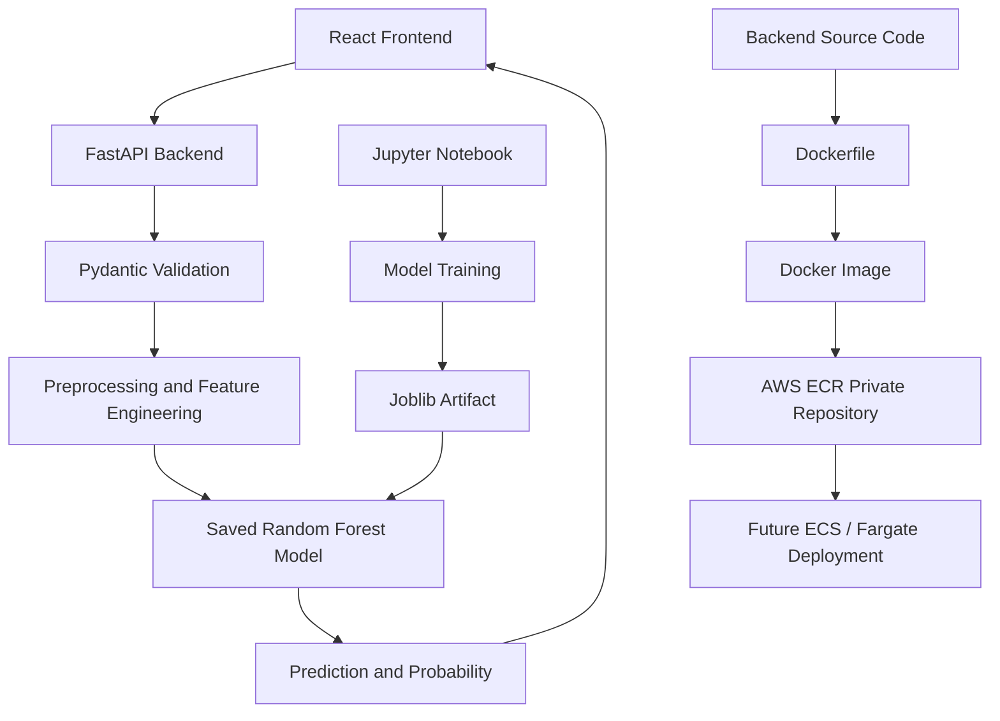

# Backend, Docker & AWS Deployment Documentation

## 1. Backend Development — FastAPI

The backend of the Heart Disease Prediction application was developed using **FastAPI**, a modern Python framework for building APIs.

It connects the trained Machine Learning model with the React frontend and handles incoming patient data, preprocessing, prediction and response generation.

### Backend Responsibilities

- Receive patient health parameters from the frontend.
- Validate incoming data using Pydantic.
- Handle specified zero values using saved training means.
- Perform categorical encoding and preprocessing.
- Generate engineered features.
- Align input columns with the trained model's feature columns.
- Generate heart disease predictions.
- Calculate prediction probabilities.
- Return prediction results in JSON format.

### Backend Folder Structure

```text
backend/
│
├── app/
│   └── main.py
│
├── models/
│   └── heart_disease_artifact.pkl
│
├── venv/
│
├── requirements.txt
├── Dockerfile
└── .dockerignore
```

### 1.1 Creating the Virtual Environment

A Python virtual environment was used to isolate project dependencies.

Navigate to the backend directory:

```powershell
cd "C:\Users\admin\Desktop\ML\Heart Disease prediction\backend"
```

Create the environment (already completed):

```powershell
python -m venv venv
```

Activate it using PowerShell:

```powershell
.\venv\Scripts\Activate.ps1
```

### 1.2 Installing Dependencies

The required Python libraries are listed in `requirements.txt`.

Install them using:

```powershell
pip install -r requirements.txt
```

### 1.3 Model Artifact Integration

The trained Machine Learning model was saved using Joblib.

Artifact location:

```text
backend/models/heart_disease_artifact.pkl
```

The serialized artifact contains:

- Trained Random Forest model.
- Training feature-column list.
- Cholesterol training mean.
- Resting blood pressure training mean.
- Age group boundaries.
- Age group labels.

The backend loads this artifact and reuses the saved model and preprocessing information for predictions.

### 1.4 FastAPI Implementation

Main application file:

```text
backend/app/main.py
```

The FastAPI application implements:

**GET `/`**

Checks whether the backend API is running.

**POST `/predict`**

Accepts patient health parameters, validates the input, performs preprocessing and returns the prediction and probability.

### 1.5 Input Validation Using Pydantic

Pydantic was used to validate incoming request data.

Validation includes:

- Age: integer between 1 and 100.
- Sex: string.
- ChestPainType: string.
- RestingBP: numeric value between 0 and 300.
- Cholesterol: numeric value between 0 and 700.
- FastingBS: integer between 0 and 1.
- RestingECG: string.
- MaxHR: integer between 1 and 250.
- ExerciseAngina: string.
- Oldpeak: numeric value.
- ST_Slope: string.

Invalid input is rejected before model prediction.

### 1.6 Prediction Workflow

The `/predict` endpoint follows this workflow:

1. Receives patient information.
2. Validates the request.
3. Handles zero values in RestingBP and Cholesterol using saved training means.
4. Encodes categorical variables.
5. Generates engineered features:
   - AgeGroup
   - MaxHR_Percentage
   - Age_Oldpeak
6. Aligns the generated features with the saved training feature columns.
7. Passes the processed input to the Random Forest model.
8. Generates the predicted class and probability.
9. Returns the result as JSON.

### 1.7 Running the Backend

Start the FastAPI application from the backend directory:

```powershell
python -m uvicorn app.main:app --reload
```

The backend runs locally at:

```text
http://127.0.0.1:8000
```

### 1.8 API Documentation

FastAPI automatically generates interactive API documentation using Swagger UI.

Open:

```text
http://127.0.0.1:8000/docs
```

Available endpoints:

| Method | Endpoint | Description |
|---|---|---|
| GET | `/` | API health check |
| POST | `/predict` | Heart disease prediction |

### 1.9 Example API Request

Endpoint:

```text
POST /predict
```

Request body:

```json
{
  "Age": 45,
  "Sex": "M",
  "ChestPainType": "ATA",
  "RestingBP": 130,
  "Cholesterol": 240,
  "FastingBS": 0,
  "RestingECG": "Normal",
  "MaxHR": 150,
  "ExerciseAngina": "N",
  "Oldpeak": 1.0,
  "ST_Slope": "Up"
}
```

Example response:

```json
{
  "prediction": 0,
  "result": "No heart disease detected",
  "heart_disease_probability": 39.56
}
```

The response is an example from local testing.

---

## 2. Frontend Integration — React + Vite

The frontend was developed using React and Vite.

It provides an interface through which users can enter patient health information and receive prediction results.

### Frontend Responsibilities

- Collect patient health parameters.
- Validate user input.
- Send requests to the FastAPI backend.
- Receive prediction responses.
- Display the prediction and probability.
- Handle API errors.

### Frontend Structure

```text
frontend/
│
├── src/
│   ├── App.jsx
│   └── App.css
│
└── package.json
```

### Running the Frontend

Open a separate PowerShell terminal:

```powershell
cd "C:\Users\admin\Desktop\ML\Heart Disease prediction\frontend"
```

Install dependencies:

```powershell
npm.cmd install
```

Start the development server:

```powershell
npm.cmd run dev
```

Frontend URL:

```text
http://localhost:5173
```

The React frontend communicates with the FastAPI backend through the `/predict` endpoint.

Both applications were integrated and tested locally.

---

## 3. Docker Containerization

Docker was used to package the FastAPI backend and its dependencies into a portable container image.

Containerization makes it easier to run the backend consistently across different environments.

### 3.1 Docker Configuration

The following files were created:

```text
backend/
│
├── Dockerfile
└── .dockerignore
```

### 3.2 Dockerfile

The Dockerfile uses Python 3.14 slim as its base image.

```dockerfile
FROM python:3.14-slim

WORKDIR /app

COPY requirements.txt .

RUN pip install --no-cache-dir -r requirements.txt

COPY app/ ./app/
COPY models/ ./models/

EXPOSE 8000

CMD ["python", "-m", "uvicorn", "app.main:app", "--host", "0.0.0.0", "--port", "8000"]
```

### 3.3 Docker Ignore Configuration

The `.dockerignore` file excludes unnecessary files from the Docker build context.

```text
venv/
__pycache__/
*.pyc
.pytest_cache/
.git/
.ipynb_checkpoints/
```

### 3.4 Building the Docker Image

Navigate to the backend directory:

```powershell
cd "C:\Users\admin\Desktop\ML\Heart Disease prediction\backend"
```

Build the image:

```powershell
docker build -t heart-disease-api .
```

This command creates a Docker image named:

```text
heart-disease-api
```

### 3.5 Running the Docker Container

Execute:

```powershell
docker run --rm -p 8000:8000 heart-disease-api
```

The backend is now accessible through the Docker container.

API:

```text
http://127.0.0.1:8000
```

Swagger documentation:

```text
http://127.0.0.1:8000/docs
```

### 3.6 Docker Testing

The containerized backend was tested successfully.

Testing included:

- Container startup.
- API health check.
- Swagger documentation access.
- Prediction endpoint.
- Valid prediction requests.
- HTTP 200 response from the prediction endpoint.

The Dockerized API successfully generated prediction responses.

---

## 4. AWS Cloud Integration — Amazon ECR

Amazon Elastic Container Registry (ECR) was used to store the Docker image in a private AWS repository.

This was an important step in preparing the backend for future cloud deployment.

### 4.1 AWS CLI Installation

AWS Command Line Interface (CLI) was installed on Windows.

Verify installation:

```powershell
aws --version
```

### 4.2 AWS Authentication

AWS authentication was completed using the AWS sign-in workflow.

The authenticated AWS identity was verified using:

```powershell
aws sts get-caller-identity
```

This command confirms the identity associated with the active AWS CLI session.

### 4.3 AWS ECR Repository

A private ECR repository was created.

Repository configuration:

| Property | Value |
|---|---|
| Cloud provider | Amazon Web Services |
| Service | Elastic Container Registry |
| Region | `ap-southeast-2` |
| Region name | Asia Pacific (Sydney) |
| Repository name | `heart-disease-api` |
| Repository type | Private |
| Image tag | `latest` |

Repository URI:

```text
321918867937.dkr.ecr.ap-southeast-2.amazonaws.com/heart-disease-api
```

### 4.4 Authenticate Docker with AWS ECR

Docker must authenticate with the private ECR registry before uploading an image.

Run:

```powershell
aws ecr get-login-password --region ap-southeast-2 | docker login --username AWS --password-stdin 321918867937.dkr.ecr.ap-southeast-2.amazonaws.com
```

This retrieves an authentication password from AWS and passes it to Docker.

The authentication password should never be committed to GitHub or shared publicly.

### 4.5 Tag the Docker Image

The locally built image was tagged with the AWS ECR repository URI.

```powershell
docker tag heart-disease-api:latest 321918867937.dkr.ecr.ap-southeast-2.amazonaws.com/heart-disease-api:latest
```

Tagging associates the local Docker image with the destination ECR repository.

### 4.6 Push the Docker Image to AWS ECR

The following command uploads the image:

```powershell
docker push 321918867937.dkr.ecr.ap-southeast-2.amazonaws.com/heart-disease-api:latest
```

**Successful result:**

```text
latest: digest: sha256:5540f2f39d22f4ead894f25c4ced67db79365579a2dd213f7b5794605f46f1a0
```

The Docker image was successfully pushed to the private AWS ECR repository.

### 4.7 AWS Deployment Status

It is important to distinguish between storing a Docker image and running an application in the cloud.

| Task | Status |
|---|---|
| AWS CLI installation | Completed |
| AWS authentication | Completed |
| AWS identity verification | Completed |
| ECR repository creation | Completed |
| Docker image build | Completed |
| Docker image tagging | Completed |
| Docker authentication | Completed |
| Docker image push to ECR | Completed |
| ECS cluster creation | Not completed |
| ECS task definition | Not completed |
| AWS Fargate deployment | Not completed |
| Public AWS backend URL | Not available |

The application has not yet been deployed as a publicly accessible AWS service.

ECR currently serves as the private container image registry.

---

## 5. Complete Backend and Cloud Workflow

The complete implementation follows this architecture:



## 6. Future Improvements

Potential improvements to the backend and deployment infrastructure include:

- Automated API testing using Pytest.
- Structured application logging.
- Better exception handling.
- Environment-based API configuration.
- SHAP-based model explainability.
- GitHub Actions CI/CD.
- Backend deployment on a hosting platform.
- React frontend deployment.
- AWS ECS/Fargate deployment.
- Monitoring and production health checks.

## 7. Important Security Notes

- Never upload AWS access keys, secret keys, session tokens, or authentication files.
- Never commit `.env` files containing secrets.
- Keep private ECR repositories private unless there is a deliberate reason to change access.
- Avoid publishing unnecessary account-specific infrastructure information.
- Use environment variables for deployment-specific configuration.

## 8. Disclaimer

This project is intended for educational and demonstration purposes.

The predictions generated by the application are not medical diagnoses and must not replace professional medical advice or clinical evaluation.